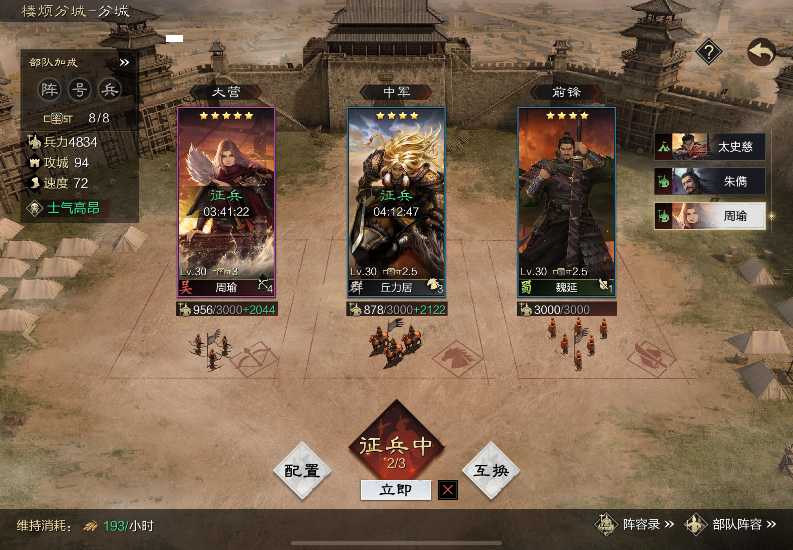

## 1 Markdown.com.cn 简介

* 支持自定义样式的 Markdown 编辑器
* 支持微信公众号、知乎和稀土掘金
* 点击右上方对应图标，一键复制到各平台

## 2 Markdown语法教程

### 2.1 标题

# 一级标题

## 二级标题

### 三级标题

### 2.2 字体

**这个是粗体**

*这个是斜体*

~~这里想用删除线~~

### 2.3 无序列表

- 无序列表 1
- 无序列表 2
- 无序列表 3
  - 无序列表 3.1
  - 无序列表 3.2
    - 无序列表 3.2.1
    - 无序列表 3.2.2

### 2.4 有序列表

1. 有序列表1
2. 有序列表2
3. 有序列表3

### 2.5 引用

> 读一本好书，就是在和高尚的人谈话。 ——歌德
> 雇佣制度对工人不利，但工人根本无力摆脱这个制度。 ——阮一峰

### 2.7 链接

这是一个链接[百度链接](https://www.google.com.hk/search?q=markdown%E8%AF%AD%E6%B3%95&oq=markdown%E8%AF%AD%E6%B3%95&gs_lcrp=EgZjaHJvbWUyBggAEEUYOTIJCAEQABgMGIAEMgkIAhAAGAwYgAQyCQgDEAAYDBiABDIJCAQQABgMGIAEMgkIBRAAGAwYgAQyCQgGEAAYDBiABDIJCAcQABgMGIAEMgcICBAAGIAEMgcICRAAGIAE0gEINTAzNWowajeoAgCwAgA&sourceid=chrome&ie=UTF-8)

### 2.8 图片

### 2.9 分割线

---
