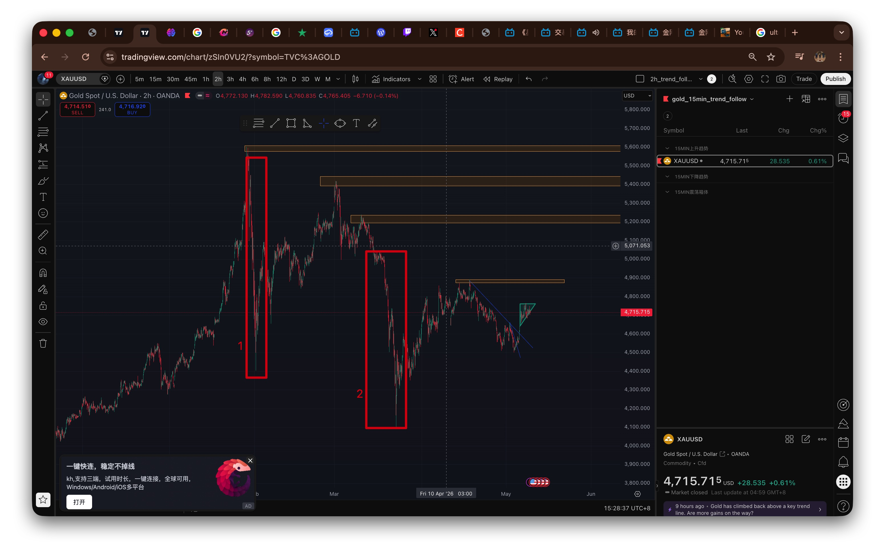
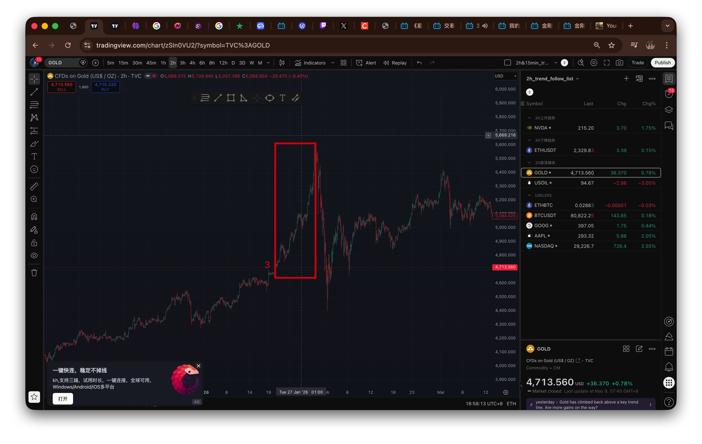

```# 1 原理

趋势跟踪。黄金是最好做的品种，非常容易单边，15min也能走出能让自己赚大钱的行情。
15min判断趋势，5min入场。

这样在2h级别震荡的时候，可以抓住15min级别的趋势。

要想赚大钱，还是得靠大级别的趋势行情，即2h趋势。但是15min的趋势就在那里，在2h震荡箱体的时候，15min同样可以走出能赚大钱的行情。

2h和15min的趋势跟踪要同时操作，因为它们并不矛盾，因为开仓信号的级别不一样，不会出现小级别止盈而大级别踏空的情况。比如下图中的红框中的3段行情：

* 红框1:2h仍然在上升趋势中，仍未出现转势信号，2h多头的大部分仓位仍然继续持有。但是小级别15min趋势是向下的，要做空；
* 红框2：2h震荡趋势中，2h级别不操作，15min向下可以做空。



* 红框3:2h上升趋势中，2h级别的仓位可能只是减仓四分之一，但是15min已经转势为空头，15min的多头仓位已经减仓70%。



# 2 开仓信号

5min级别的单边水平三角形真突破。

由于K线级别越小，pinbar的有效性越弱，并且为了避免频繁操作，所以做短线不用回调假突破的开仓信号。

# 3 减仓信号

* 15min强支阻位减仓当前仓位的25%；
* 15min出现趋势终结1-2-3法则，分3批减仓当前所有仓位的70%。

# 4 风控

单笔开仓为总资金的0.5%-1%。、

# 5 品种

gold.
为了避免频繁操作，15min趋势跟踪只做黄金一个品种。

**不一定所有品种都适合自己的交易系统，目前来看，黄金是适合自己的交易系统的。**

# 6 此交易系统不可执行

**要想赚大钱，还是得跟踪大周期的趋势，即2h级别的趋势（只做小周期15min趋势会出现止盈了但是行情继续正向运行的情况，即大周期踏空）。但是行情可能大周期还没出现止盈信号而出现v形反转会导致大部分浮盈丢失。所以，可行的方法是大周期和小周期的趋势都跟踪（即短线和长线都做）。而在小周期来看，大部分品种是不适合做的，因为大部分品种小周期没有那么好的趋势性，只有黄金是适合的。只做黄金一个品种的小周期趋势跟踪，就相当于多了一个品种的2h趋势跟踪（只不过实现盈亏的时间缩短了而已），会大大加快自己资金做大的速度。**

关键点：主线还是做2h趋势跟踪，把黄金的15min趋势跟踪当成盈亏实现时间缩短了的一个2h趋势品种就可以了。

行情的不可预测性和随机性最终导致自己做出了这样的应对方案，即2h和15min趋势都跟踪。这样，无论行情怎么走，自己最终都会是赚的（有效地避免了浮盈大幅度回撤和踏空）。

* 如果2h在震荡，15min有趋势，那自己的2h级别空仓，15min趋势跟踪会赚钱；
* 如果2h大涨之后V形反转，那自己的2h级别的仓位可能减仓4分之一，但15min仓位已经平掉大部分仓位止盈了，并且可能出现15min做空机会已经做空了；
* 如果2h行情一直大涨，那自己的2h级别仓位在一直持有，15min仓位可能平掉大部分仓位止盈了。
```

但是，频繁操作必死，5min级别的入场信号非常容易导致频繁操作，短时间内连续止损5次的情况是非常容易出现的，很可能坐在电脑前忙活了一天，百分之十几的本金已经没了。所以自己还是继续执行自己的多品种2h趋势跟踪交易系统。

